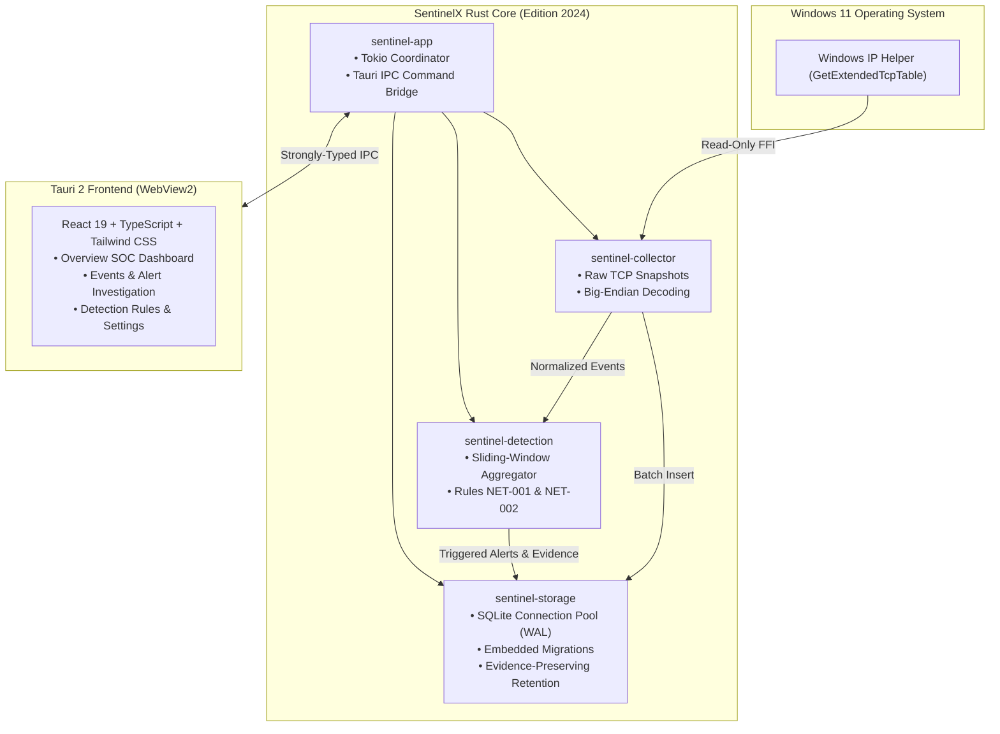

# SentinelX: Defensive Threat Detection & Monitoring Platform for Windows 11

[](https://github.com/sentinelx/sentinelx/releases)
[](https://www.rust-lang.org/)
[]()
[](https://opensource.org/licenses/MIT)
[](https://tauri.app/)
[](https://react.dev/)

SentinelX is an educational, local-first defensive cybersecurity monitoring desktop application built specifically for Windows 11. It continuously samples host network state via read-only Windows IP Helper APIs, normalizes raw telemetry into structured events, detects suspicious connection patterns (such as port sweeps and connection bursts) via stateful in-memory sliding windows, and provides persistent storage and a reactive desktop SOC dashboard.

> **Operational & Scope Notice:**  
> SentinelX is an educational defensive security monitoring project. Its network telemetry operates via periodic (default: 1,000 ms) read-only Windows TCP connection snapshots using `GetExtendedTcpTable`. It operates with **standard user permissions** (no administrator rights or UAC elevation needed), requires **no kernel or packet capture drivers**, and **neither modifies nor terminates network sockets**.
> 
> It does not provide complete packet inspection or comprehensive endpoint detection, and it may miss short-lived connections and activity outside its supported collection scope.

---

## Table of Contents

1. [Problem Statement & Goals](#problem-statement--goals)
2. [Key Implemented Features](#key-implemented-features)
3. [Architecture Overview](#architecture-overview)
4. [Technology Stack](#technology-stack)
5. [System Requirements](#system-requirements)
6. [Installation & Windows Packaging](#installation--windows-packaging)
7. [Developer Setup & Build Instructions](#developer-setup--build-instructions)
8. [Usage & Operator Workflow](#usage--operator-workflow)
9. [Security, Privacy & Threat Design](#security-privacy--threat-design)
10. [Testing & Quality Assurance](#testing--quality-assurance)
11. [Project Structure](#project-structure)
12. [Known Limitations](#known-limitations)
13. [Roadmap](#roadmap)
14. [Documentation Index](#documentation-index)
15. [License & Notices](#license--notices)

---

## 1. Problem Statement & Goals

Modern Windows endpoints face continuous threats from unauthorized reconnaissance, lateral movement sweeps, and anomalous connection volume surges. Conventional enterprise EDR solutions often rely on proprietary cloud backends and intrusive kernel drivers, introducing privacy risks, heavy memory footprints, and high complexity.

### Core Goals & Design Principles
1. **Defensive Non-Interference:** SentinelX is strictly passive. It observes and reasons over telemetry without dropping packets, modifying network routing, or terminating user processes.
2. **Local-First & Zero Cloud:** 100% of telemetry, detection rules, alerts, and audit trails remain on the local disk. No external network traffic is generated.
3. **Privilege Minimization:** Operates entirely within an unprivileged Windows user context (Medium Integrity). No kernel drivers (`.sys`), no Windows services, and no UAC prompts.
4. **Deterministic & Bounded Execution:** All sliding windows, evidence collections, and database queries enforce strict memory bounding, checked conversions, and zero-panic runtime paths.
5. **Relational Integrity:** Foreign keys and Write-Ahead Logging (WAL) protect against corruption and ensure concurrent UI queries never block background batch inserts.

---

## 2. Key Implemented Features

- **Windows IP Helper Telemetry Collection:** Periodic read-only TCP table inspection (`GetExtendedTcpTable`) with full Big-Endian decoding for IPv4, IPv6, and ports.
- **Process Attribution:** Maps every active socket to its owning Windows Process ID (PID).
- **Rule NET-001 (Port Scan Detection):** Tracks distinct destination ports targeted per source IP within a sliding 60-second window (default threshold: 10 ports) with alert cooldown suppression.
- **Rule NET-002 (Connection Burst Anomaly):** Detects anomalous surges in established connections from a single IP (default threshold: 20 connections in 60s).
- **SQLite Persistence & Embedded Migrations:** Version-controlled schema migrations (`0001` through `0003`) compiled directly into the binary with foreign-key enforcement and WAL mode.
- **Evidence-Preserving Retention:** Prunes historical events older than 30 days while permanently preserving any event referenced as evidence for an active security alert.
- **Immutable Audit Logging:** Full non-repudiation audit trail for alert acknowledgments, resolutions, and rule updates.
- **Tauri 2 Reactive Desktop Dashboard:** Overview SOC KPIs, interactive time-series timeline charts, event and alert tables, alert deep-dive inspection, and settings controls.
- **Windows NSIS Installer:** Native standalone installer package configured for per-user installation.

---

## 3. Architecture Overview

SentinelX is organized as a modular Cargo virtual workspace with strictly decoupled crates:



### Crate Taxonomy
- **`sentinel-core`**: Canonical domain types (`NetworkEvent`, `SecurityAlert`, `ProcessId`, `AlertSeverity`).
- **`sentinel-collector`**: Native Windows API collection and deterministic mock simulator.
- **`sentinel-detection`**: Analytical sliding-window detection engine and rule implementations.
- **`sentinel-storage`**: SQLite persistence, transactional batch writes, and retention manager.
- **`sentinel-app`**: Tauri 2 application commands, background scheduler, and state orchestration.
- **`ui`**: React 19 frontend application.

---

## 4. Technology Stack

- **Core Backend:** Rust (2024 Edition, Rust 1.85+)
- **Asynchronous Runtime:** `tokio` (multi-threaded, timers, signals)
- **Desktop Framework:** Tauri 2 (`@tauri-apps/api 2.12.4`, `tauri 2.12.5`)
- **Frontend Stack:** React 19, TypeScript 5.8, Vite 8, Tailwind CSS 4, Lucide Icons, Recharts
- **Database & Persistence:** SQLite 3 via `sqlx` (WAL journal mode, embedded migrations)
- **Windows API:** `windows-sys` (`Win32_NetworkManagement_IpHelper`, `Win32_Networking_WinSock`)
- **Testing:** `proptest` (property testing), Vitest, `tempfile`

---

## 5. System Requirements

- **Operating System:** Windows 11 (64-bit, Version 22H2 or newer).
- **Architecture:** x86_64 (`x86_64-pc-windows-msvc`).
- **RAM:** Minimum 2 GB (SentinelX idle footprint is ~48 MB).
- **Disk Space:** 50 MB for application binaries and database.
- **Permissions:** Standard User account. Administrative elevation is **not** required.

---

## 6. Installation & Windows Packaging

### 6.1 Download
Download the official release installer:
- **Installer:** `SentinelX_1.0.0_x64-setup.exe`
- **SHA-256 Checksum:** `63A86984E27B419F28A5AC4EECDA77B59EE189222BB3E186BA541026F2B81BE0`

### 6.2 Running Setup
1. Double-click `SentinelX_1.0.0_x64-setup.exe`.
2. On Windows Defender SmartScreen (*"Windows protected your PC"*), click **More info** > **Run anyway**. *(See [SmartScreen Disclosure](docs/user/INSTALLATION_AND_UNINSTALLATION.md#step-2-running-setup)).*
3. The installer installs the application to `%LOCALAPPDATA%\Programs\SentinelX\` and creates Start Menu shortcuts.
4. Launch SentinelX from the Start Menu.

---

## 7. Developer Setup & Build Instructions

For complete prerequisites and toolchain setup, see [BUILD_WINDOWS.md](docs/development/BUILD_WINDOWS.md).

### Quick Commands

```powershell
# 1. Clone repository
git clone https://github.com/sentinelx/sentinelx.git
cd sentinelx

# 2. Install frontend dependencies from lockfile
cd ui; npm ci; cd ..

# 3. Run all tests and release verification pipeline
.\scripts\verify-release.ps1

# 4. Or build desktop NSIS installer directly
npx --prefix ui tauri build --bundles nsis
```

---

## 8. Usage & Operator Workflow

1. **Dashboard Overview:** Monitor host telemetry health, real-time traffic charts, and active alerts.
2. **Network Events:** Inspect active TCP connections, local/remote endpoints, socket states, and PIDs.
3. **Alert Investigation:** Click any alert to open the deep-dive view and review the exact sequence of correlated evidence connections.
4. **Triage Lifecycle:** Acknowledge alerts under investigation and Resolve incidents with operational notes.
5. **Rule Configuration:** Tune distinct port thresholds, window durations, and alert cooldowns via the Detection Rules view.

---

## 9. Security, Privacy & Threat Design

- **STRIDE Threat Model:** Evaluated against all STRIDE categories (see [THREAT_MODEL.md](docs/architecture/THREAT_MODEL.md)).
- **Zero Cloud Transmission:** All telemetry and database records remain strictly local to `%LOCALAPPDATA%\SentinelX\`. No outbound network calls exist.
- **Least Privilege:** Standard user execution; no kernel drivers; Tauri capabilities restricted to `core:default`.
- **Content Security Policy:** Strict CSP (`script-src 'self'`) blocking inline/remote scripts.

---

## 10. Testing & Quality Assurance

SentinelX maintains 100% automated test pass rates across all layers:
- **Rust Unit & Property Tests:** 72 unit and property tests verifying domain models, byte order translation, and detection window invariants.
- **Integration Tests:** 9 storage integration tests (`storage_integration.rs`) and full pipeline tests (`detection_pipeline.rs`).
- **Failure Injection:** 6 failure injection tests (`failure_injection.rs`) verifying graceful handling of API errors and corrupt states.
- **Frontend Tests:** Vitest component tests verifying navigation, triage actions, and views.
- **Static Analysis:** Clean `cargo fmt`, `cargo clippy -- -D warnings`, and `oxlint`.

---

## 11. Project Structure

```text
SentinelX/
├── Cargo.toml                    # Virtual workspace manifest (v1.0.0)
├── Cargo.lock                    # Pinned Rust dependencies
├── rust-toolchain.toml           # Toolchain configuration (stable, 2024)
├── crates/
│   ├── sentinel-core/            # Domain models and strong identifiers
│   ├── sentinel-collector/       # Windows IP Helper FFI and mock collector
│   ├── sentinel-detection/       # In-memory sliding window detection engine
│   ├── sentinel-storage/         # SQLite persistence and embedded migrations
│   └── sentinel-app/             # Tauri 2 commands, scheduler, and desktop entry
├── ui/                           # React 19 + TypeScript + Tailwind CSS desktop UI
├── scripts/
│   └── verify-release.ps1        # Automated release verification pipeline
└── docs/
    ├── architecture/             # Architecture, Data Flow, Threat Model, Database
    ├── development/              # Windows 11 Build & Development Guide
    ├── release/                  # Readiness, Build Verification, Notes, SBOM
    ├── security/                 # Dependency Audit & Final Security Review
    ├── testing/                  # Release Test Plan & Execution Report
    ├── user/                     # Quick Start, User Guide, Troubleshooting, Privacy
    └── portfolio/                # Overview, Demo Script, Interview Prep
```

---

## 12. Known Limitations

1. **Snapshot Polling Blindspot:** SentinelX samples the Windows TCP table periodically (default: 1,000ms). Transient connections that open and close in <10ms between polling cycles may not be captured.
2. **Metadata-Only Scope:** Payload content, HTTP headers, TLS session data, and DNS queries are not inspected.
3. **Defensive Non-Interference:** SentinelX does not block connections or terminate host processes.
4. **Code Signing:** Binary is distributed unsigned; Windows SmartScreen will display an "Unknown Publisher" dialog on initial launch.

---

## 13. Roadmap

- **v1.1:** Event Tracing for Windows (ETW) provider integration to capture transient sub-polling connections.
- **v1.2:** Process executable resolution (mapping PIDs to full executable paths and file hashes).
- **v1.3:** Built-in one-click database export/backup directly in the desktop UI.

---

## 14. Documentation Index

- **Architecture:** [OVERVIEW.md](docs/architecture/OVERVIEW.md) | [DATA_FLOW.md](docs/architecture/DATA_FLOW.md) | [THREAT_MODEL.md](docs/architecture/THREAT_MODEL.md) | [DATABASE.md](docs/architecture/DATABASE.md)
- **Development:** [BUILD_WINDOWS.md](docs/development/BUILD_WINDOWS.md)
- **Release:** [RELEASE_READINESS.md](docs/release/RELEASE_READINESS.md) | [BUILD_VERIFICATION.md](docs/release/BUILD_VERIFICATION.md) | [RELEASE_NOTES.md](docs/release/RELEASE_NOTES.md) | [SBOM_AND_CHECKSUMS.md](docs/release/SBOM_AND_CHECKSUMS.md)
- **Security:** [DEPENDENCY_SECURITY.md](docs/security/DEPENDENCY_SECURITY.md) | [FINAL_SECURITY_REVIEW.md](docs/security/FINAL_SECURITY_REVIEW.md)
- **Testing:** [RELEASE_TEST_PLAN.md](docs/testing/RELEASE_TEST_PLAN.md)
- **User Guides:** [QUICK_START.md](docs/user/QUICK_START.md) | [USER_GUIDE.md](docs/user/USER_GUIDE.md) | [INSTALLATION_AND_UNINSTALLATION.md](docs/user/INSTALLATION_AND_UNINSTALLATION.md) | [TROUBLESHOOTING.md](docs/user/TROUBLESHOOTING.md) | [PRIVACY.md](docs/user/PRIVACY.md) | [DATA_BACKUP_AND_RESTORE.md](docs/user/DATA_BACKUP_AND_RESTORE.md)
- **Portfolio:** [PROJECT_OVERVIEW.md](docs/portfolio/PROJECT_OVERVIEW.md) | [SCREENSHOT_GUIDE.md](docs/portfolio/SCREENSHOT_GUIDE.md) | [DEMO_SCRIPT.md](docs/portfolio/DEMO_SCRIPT.md) | [INTERVIEW_PREPARATION.md](docs/portfolio/INTERVIEW_PREPARATION.md)

---

## 15. License & Notices

SentinelX is licensed under the [MIT License](LICENSE).  
Copyright (c) 2026 SentinelX Contributors.
