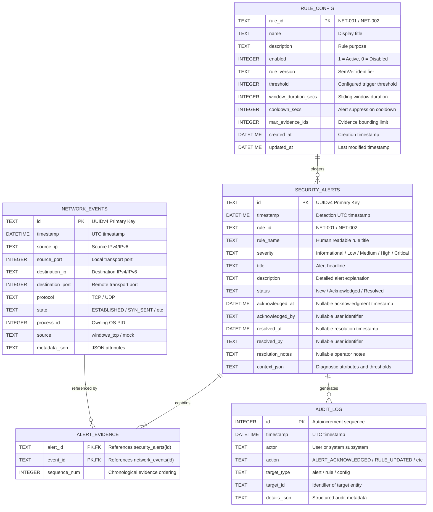

# SentinelX SQLite Database Architecture & Schema Specification

SentinelX uses an embedded SQLite database configured for high-concurrency local storage. All schema migrations are compiled directly into the Rust binary using SQLx embedded migrations (`sqlx::migrate!("./migrations")`), ensuring seamless initial startup and in-place upgrades without external SQL file dependencies.

---

## 1. SQLite PRAGMA Configuration

On every connection initialization, SentinelX enforces strict integrity and concurrency PRAGMAs:

```sql
PRAGMA journal_mode = WAL;         -- Write-Ahead Logging allows concurrent readers and writer
PRAGMA synchronous = NORMAL;       -- Balances durability with high-throughput batch inserts
PRAGMA foreign_keys = ON;          -- Strictly enforces referential integrity across all tables
PRAGMA busy_timeout = 5000;        -- 5-second wait queue to prevent transient lock contention
```

---

## 2. Entity-Relationship Schema Diagram



---

## 3. Migration History & Evolution

Embedded migrations reside in `crates/sentinel-storage/migrations/`:

### Migration 0001: Initial Schema (`0001_initial_schema.sql`)
- Creates core tables: `network_events`, `security_alerts`, `alert_evidence`, and `audit_log`.
- Establishes cascading foreign key from `alert_evidence` to `security_alerts(id)`.
- Enforces composite primary key on `alert_evidence(alert_id, event_id)`.

### Migration 0002: Performance Indexes (`0002_detection_indexes.sql`)
Creates composite indexes to ensure query performance remains under 10ms as event tables grow:
- `idx_events_timestamp_source_ip`: Fast filtering for IP-centric sliding windows.
- `idx_events_source_ip_dest_port`: Accelerated distinct port counting for NET-001.
- `idx_alerts_status_severity`: Immediate filtering on SOC dashboard counters.
- `idx_audit_timestamp_actor`: Chronological audit log traversal.

### Migration 0003: Dynamic Rule Configuration (`0003_rule_config.sql`)
- Creates `rule_config` table allowing persistent runtime tuning of detection thresholds, window durations, and cooldown parameters from the Settings and Detection Rules pages.
- Seeds default configurations for `NET-001` (Port Scan) and `NET-002` (Connection Burst).

---

## 4. Evidence-Preserving Retention Policy

The `RetentionManager` (`crates/sentinel-storage/src/retention.rs`) implements a defensive retention strategy:

```sql
DELETE FROM network_events 
WHERE timestamp < ? 
  AND id NOT IN (SELECT event_id FROM alert_evidence);
```

### Safety Rules:
1. **Evidence Protection:** Telemetry events linked to security alerts are **never** deleted by automated aging, ensuring forensics integrity.
2. **Audit Preservation:** Audit logs default to a 90-day retention window, longer than normal telemetry (default: 30 days).
3. **Chunked Deletion:** Deletions execute in bounded batches (500 rows per transaction) to prevent lock contention on host storage.
