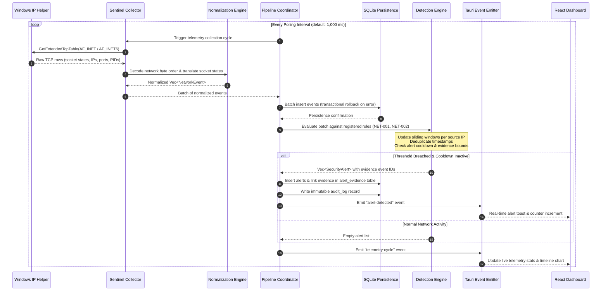

# SentinelX Event Data Flow & Processing Pipeline

This document describes how network observations originate in the Windows kernel, flow through SentinelX normalization and detection logic, persist to disk, and stream to the desktop user interface.

---

## 1. End-to-End Data Flow Pipeline



---

## 2. Pipeline Processing Stages

### Stage 1: Snapshot Collection (`GetExtendedTcpTable`)
- The background Tokio timer triggers every configured interval (default: 1,000 ms).
- Queries both IPv4 (`AF_INET`) and IPv6 (`AF_INET6`) TCP tables.
- Retrieves:
  - Local address and local port.
  - Remote address and remote port.
  - Connection state (`MIB_TCP_STATE_ESTAB`, `MIB_TCP_STATE_SYN_SENT`, `MIB_TCP_STATE_TIME_WAIT`, etc.).
  - Owning Process ID (`dwOwningPid`).

### Stage 2: Normalization & Filtering
- Network byte order ports (`u16`) are decoded using Big-Endian conversion (`u16::from_be`).
- IPv4 addresses (`u32`) are converted into standard `std::net::Ipv4Addr`.
- IPv6 addresses (`[u8; 16]`) are converted into `std::net::Ipv6Addr`.
- Sockets in `MIB_TCP_STATE_LISTEN` are filtered out of active threat detection streams.
- Sockets with invalid port 0 are discarded.
- Each valid connection is wrapped into an immutable `NetworkEvent` domain entity with a unique UUIDv4 and UTC timestamp.

### Stage 3: Transactional Persistence
- The batch of normalized events is written to the SQLite database `network_events` table within an atomic transaction.
- If any write fails, the transaction is rolled back, preventing orphaned partial records.
- WAL mode ensures that background writes do not block simultaneous read queries from the dashboard UI.

### Stage 4: Stateful Threat Detection
The normalized events are passed to the `DetectionEngine`, which routes them to all active detection rules:
- **Rule NET-001 (Port Scan Detection):**
  - Maintains a sliding window (default: 60s) of distinct destination ports targeted per source IP.
  - If distinct ports exceed threshold (default: 10), triggers a `SecurityAlert` with associated event IDs as evidence.
  - Enforces a cooldown window (default: 300s) to suppress alert flooding from continuous scanning.
- **Rule NET-002 (Connection Burst Anomaly):**
  - Tracks total connection creation frequency per source IP over a 60s window.
  - Triggers if new connections exceed burst threshold (default: 20).

### Stage 5: Alert Persistence & Audit Logging
- When an alert triggers, it is written to the `security_alerts` table.
- References to all contributing events are inserted into the `alert_evidence` join table.
- An immutable entry is written to `audit_log` detailing the detection rule, severity, and target IP.

### Stage 6: Real-Time UI Dispatch
- Tauri emits native IPC events (`alert-detected`, `telemetry-cycle`).
- The React dashboard receives events via Tauri listener hooks and updates UI counters, charts, and toast notifications without requiring full-page reloads.

### Stage 7: Retention Management
- Periodically, or on application shutdown, `RetentionManager` runs a purge cycle:
  ```sql
  DELETE FROM network_events 
  WHERE timestamp < ? 
    AND id NOT IN (SELECT event_id FROM alert_evidence)
  ```
- Events older than the configured threshold (default: 30 days) are pruned, but **any event linked as alert evidence is strictly preserved**.
