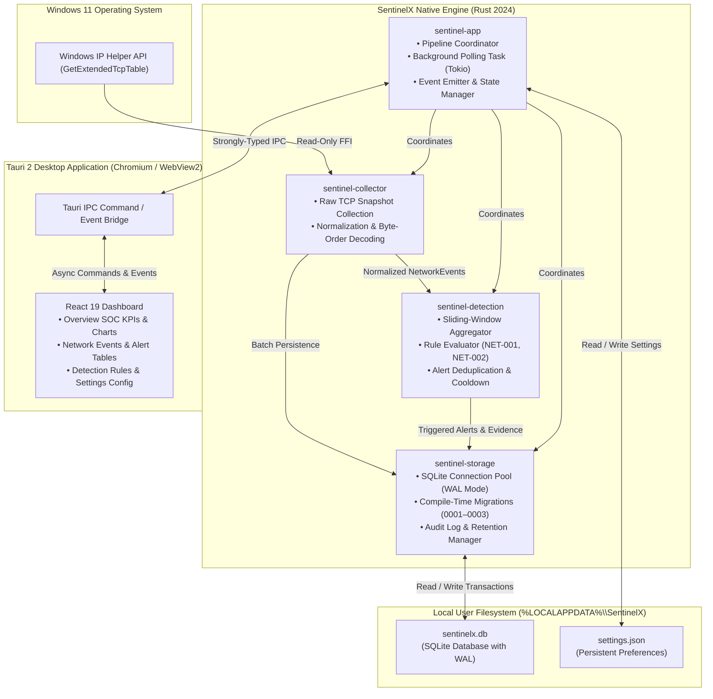

# SentinelX System Architecture Overview

SentinelX is a local-first, defensive cybersecurity monitoring desktop application built specifically for Windows 11. It continuously inspects host network state via read-only Windows IP Helper APIs, normalizes raw telemetry into structured events, detects suspicious connection patterns (such as port sweeps and connection bursts) via stateful in-memory sliding windows, and provides persistent storage and a desktop SOC dashboard.

---

## 1. High-Level Architecture Diagram



---

## 2. Workspace Crate Architecture

The codebase is organized as a Cargo workspace with strict layer boundaries:

| Crate | Responsibility | Core Dependencies | Unsafe Policy |
| :--- | :--- | :--- | :--- |
| **`sentinel-core`** | Canonical domain types: `NetworkEvent`, `SecurityAlert`, `DetectionConfig`, `AlertSeverity`, strongly-typed UUID identifiers. | `serde`, `chrono`, `uuid`, `thiserror` | `#![deny(unsafe_code)]` |
| **`sentinel-collector`** | Native Windows telemetry collection via `GetExtendedTcpTable`, big-endian port decoding, socket normalization, and deterministic mock collector. | `sentinel-core`, `windows-sys` | Isolated `unsafe` FFI in `windows_tcp.rs` |
| **`sentinel-detection`** | Rule evaluation, in-memory sliding windows, alert cooldown suppression, and threshold scaling for NET-001 (Port Scan) and NET-002 (Burst). | `sentinel-core` | `#![deny(unsafe_code)]` |
| **`sentinel-storage`** | Local SQLite persistence, compile-time embedded migrations, transactional batch insertions, audit logging, and evidence-preserving retention. | `sentinel-core`, `sqlx` (WAL, sqlite) | `#![deny(unsafe_code)]` |
| **`sentinel-app`** | Tauri 2 desktop lifecycle, asynchronous command handlers, background Tokio scheduler, and event streaming. | All crates, `tauri`, `tokio`, `tracing` | `#![deny(unsafe_code)]` |
| **`ui`** | Single-page SOC desktop dashboard built with React 19, TypeScript, Tailwind CSS, Lucide icons, and Recharts. | React 19, `@tauri-apps/api`, Vite, Vitest | Managed by TypeScript & Oxlint |

---

## 3. Trust Boundaries & Security Model

```mermaid
graph LR
    subgraph UntrustedZone ["Untrusted / External Environment"]
        NetPackets["Network Traffic (Remote Hosts)"]
    end

    subgraph WindowsOS ["Windows Kernel / Subsystem"]
        TCPTable["Kernel TCP State Table"]
    end

    subgraph UserSpace ["User Execution Context (Medium Integrity)"]
        NativeRust["SentinelX Native Rust Engine<br/>• Parameterized Queries<br/>• Memory Safe<br/>• Read-Only Telemetry"]
        LocalData["Local Filesystem (%LOCALAPPDATA%\\SentinelX)<br/>• sentinelx.db (Per-User Restricted)"]
    end

    subgraph RendererSandbox ["Webview Sandbox (Tauri 2)"]
        Frontend["React UI Renderer<br/>• Strict CSP (script-src 'self')<br/>• No FS/Shell Access<br/>• Bound IPC Interface"]
    end

    NetPackets -.->|Establishes Sockets| TCPTable
    TCPTable -->|GetExtendedTcpTable FFI| NativeRust
    NativeRust <-->|SQLite Transactions| LocalData
    NativeRust <==|Type-Checked IPC Commands| Frontend
```

### Trust Boundary Rules
1. **Frontend Isolation:** The React webview is strictly unprivileged. It cannot read the filesystem, spawn operating system processes, or communicate directly over the network. It communicates with Rust exclusively via typed Tauri IPC invocations.
2. **Standard User Privilege:** SentinelX does not require administrative elevation or kernel-level drivers. It queries only the connection state visible to a standard user session.
3. **Local-First Boundary:** Telemetry and alert data never cross external network boundaries. All persistence is strictly local to `%LOCALAPPDATA%\SentinelX`.
