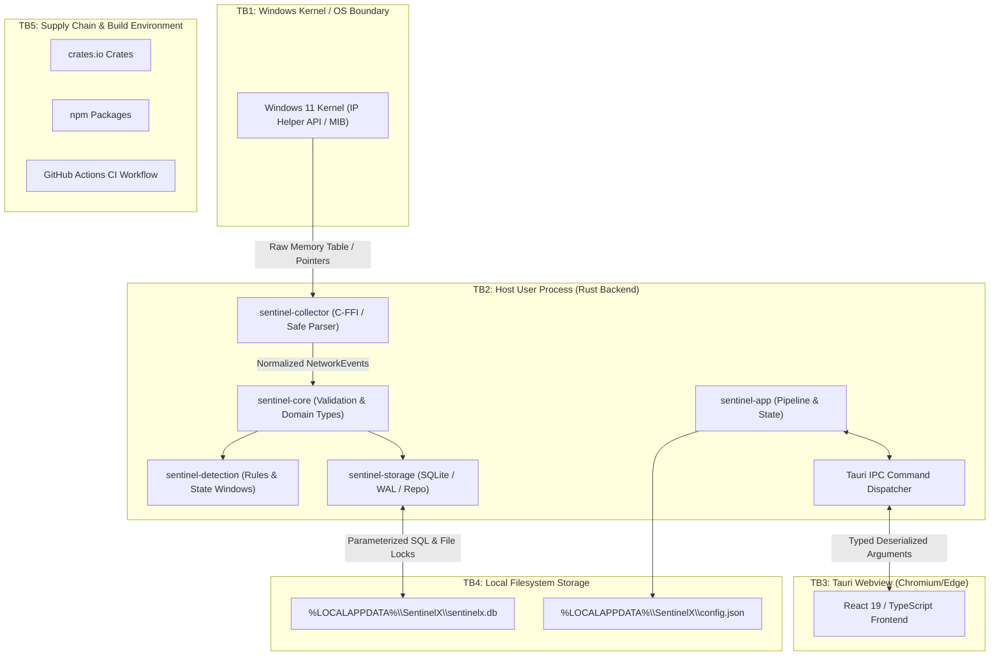

# Threat Model: SentinelX

## 1. System Overview & Scope

SentinelX is a host-based, defensive cybersecurity monitoring desktop application designed for Windows 11. It collects local TCP connection state telemetry via Windows IP Helper APIs, normalizes and validates events, evaluates them against analytical detection rules (e.g., port scan sweeps and connection bursts), persists records and alerts in an embedded SQLite database, and presents actionable insights through a Tauri 2 desktop dashboard.

SentinelX is intentionally host-local: it does not expose network listeners, does not transmit data to external cloud services, and does not perform active containment or host mutations (e.g., firewall modification, socket termination, or process killing).

---

## 2. Asset Inventory

| Asset Identifier | Asset Name | Description & Security Sensitivity |
| :--- | :--- | :--- |
| **AST-01** | **Network Event Records** | Historical log of local TCP socket telemetry (endpoints, process IDs, timestamps). High integrity, moderate confidentiality. |
| **AST-02** | **Security Alerts & Evidence** | Correlated security incidents, detection fingerprints, severity levels, and linked evidence event IDs. High integrity, high availability. |
| **AST-03** | **Application Configuration** | Polling intervals, database path, demo mode settings, UI themes, and log verbosity. Moderate integrity. |
| **AST-04** | **Detection Rule Configuration** | Thresholds, rolling-window durations, and cooldown intervals for rules like NET-001 and NET-002. High integrity (tampering causes evasion or false alarms). |
| **AST-05** | **SQLite Database** | On-disk storage (`sentinelx.db`) containing events, alerts, evidence associations, and audit trails. High integrity, moderate confidentiality. |
| **AST-06** | **Audit Records** | Immutable audit log of operator actions (alert acknowledgements, resolutions, settings modifications, retention runs). Critical integrity. |
| **AST-07** | **Windows Telemetry Stream** | Unfiltered raw socket snapshots obtained from the Windows kernel IP Helper API. High integrity, moderate confidentiality. |
| **AST-08** | **Tauri Command Interfaces** | Typed IPC boundary between the unprivileged React webview and the privileged Rust application core. Critical integrity. |
| **AST-09** | **Release & Build Artifacts** | Compiled binaries (`.exe`), installers (`.msi`), updater manifests, and dependencies. Critical integrity and authenticity. |

---

## 3. Trust Boundaries

### Trust Boundary Descriptions:
1. **TB1: Windows Kernel / OS Boundary**: Data crossing from native C-FFI pointers into Rust safe abstractions. Unsafe pointer reading and buffer boundary validation required.
2. **TB2: Core Rust Engine**: In-memory boundary between domain crates (`sentinel-core`, `sentinel-detection`, `sentinel-storage`, `sentinel-app`). Enforces Rust type invariants and memory safety.
3. **TB3: Webview IPC Boundary**: Untrusted input originating from the JavaScript frontend (potentially compromised by XSS or webview exploit) crossing into the privileged Rust runtime.
4. **TB4: Local Filesystem Boundary**: Access to on-disk database files and configuration. Protected by Windows DACLs (per-user `%LOCALAPPDATA%`).
5. **TB5: Supply Chain Boundary**: Third-party dependencies integrated during build and compilation.

---

## 4. Threat Analysis (STRIDE)

### Threat 1: Malformed Telemetry Buffer Causing Buffer Overflow or Panic
- **STRIDE**: Denial of Service / Elevation of Privilege
- **Affected Component**: `sentinel-collector::windows_tcp` (TB1)
- **Attack Preconditions**: Attacker generates malformed TCP tables or manipulates buffer length returned by `GetExtendedTcpTable`.
- **Potential Impact**: Native process crash (denial of service) or potential memory corruption via buffer over-read.
- **Existing Controls**: `GetExtendedTcpTable` dynamically queries required buffer size; bounds buffer allocation check; uses `std::ptr::read_unaligned`; enforces `MAX_SNAPSHOT_RECORDS = 50,000` upper bound; arithmetic checks using `checked_add` and `checked_mul`.
- **Mitigation Status**: Fully mitigated. Documented with `// SAFETY:` rationale.
- **Verification Method**: Unit tests `test_native_windows_collection_live`, property tests in `crates/sentinel-collector/tests/property_tests.rs`.
- **Residual Risk**: Zero in safe Rust. Relies on Microsoft Windows kernel guaranteeing `dwNumEntries` and table struct definitions match MIB specifications.

### Threat 2: Compromised Webview Attempting Arbitrary Filesystem or Shell Execution
- **STRIDE**: Elevation of Privilege
- **Affected Component**: `sentinel-app` Tauri capabilities & IPC (TB3)
- **Attack Preconditions**: Malicious script injection into webview or malicious dependency in UI bundle.
- **Potential Impact**: Arbitrary code execution or unauthorized reading/writing of sensitive host files.
- **Existing Controls**: Tauri 2 capability configuration strictly restricts permissions to `core:default` and `windows: ["main"]`. The `shell` and `fs` plugins are omitted entirely. No command exists to read arbitrary files or run child processes.
- **Mitigation Status**: Fully mitigated.
- **Verification Method**: Inspection of `crates/sentinel-app/capabilities/default.json` and verification that only internal commands are registered in `main.rs`.
- **Residual Risk**: Low. Any future command addition must undergo strict capability scoping.

### Threat 3: SQL Injection via Search Filters or Malformed Parameters
- **STRIDE**: Tampering / Information Disclosure
- **Affected Component**: `sentinel-storage::database`, `events`, `alerts`, `audit` (TB2, TB4)
- **Attack Preconditions**: Frontend sends specially crafted search strings, IP addresses, or sorting parameters containing SQL control characters.
- **Potential Impact**: Unauthorized extraction of event history, alteration of alerts, or deletion of audit logs.
- **Existing Controls**: 100% of SQL statements across all repositories use sqlx parameterized queries (`?1`, `?2`). No user-controlled dynamic SQL concatenation exists. Sort order is constrained to boolean `sort_desc`, and column names are hardcoded in query definitions.
- **Mitigation Status**: Fully mitigated.
- **Verification Method**: Code review and integration tests `test_pagination_and_time_filtering` and `test_frontend_command_validation_rejections`.
- **Residual Risk**: Negligible.

### Threat 4: Resource Exhaustion via Event or Alert Flooding (Denial of Service)
- **STRIDE**: Denial of Service
- **Affected Component**: `sentinel-detection`, `sentinel-storage`, `sentinel-app::pipeline` (TB2)
- **Attack Preconditions**: Host experiences massive burst of network connections (e.g., worm propagation, high-volume port scan, or synthetic simulator).
- **Potential Impact**: Out-of-memory (OOM) crash, database lock contention, unbounded disk growth, UI freeze.
- **Existing Controls**:
  - `DetectionEngine` enforces `max_batch_size = 100,000`. Batches exceeding this are rejected.
  - Telemetry collection is strictly single-task bounded: subsequent cycles skip if a collection is already active (`is_running`).
  - Detection rules bound evidence attached to a single alert to `MAX_EVIDENCE_COUNT = 1,000`.
  - Configurable retention policy purges historical events and audit records on a schedule.
  - Alert correlation groups repeated bursts into existing alerts via stable fingerprinting, preventing alert explosion.
- **Mitigation Status**: Fully mitigated.
- **Verification Method**: Benchmark test `run_empirical_performance_benchmarks` verifying sustained 17k+ events/sec throughput and empirical memory/disk bounding.
- **Residual Risk**: High-frequency sustained network activity will cause SQLite file growth up to the retention threshold (`retention_days`). Disk storage must be monitored.

### Threat 5: Tampering with SQLite Database and Audit Trails by Local Processes
- **STRIDE**: Tampering / Repudiation
- **Affected Component**: `sentinel-storage`, `%LOCALAPPDATA%\SentinelX\sentinelx.db` (TB4)
- **Attack Preconditions**: Another process running under the same Windows user session opens and modifies `sentinelx.db`.
- **Potential Impact**: Deletion of forensic evidence, alteration of alert status, or forgery of audit entries.
- **Existing Controls**: SQLite WAL mode enforces file locking; foreign key constraints enforce referential integrity; database path is stored in user profile directory (`%LOCALAPPDATA%`) with default Windows user DACLs; `AuditEntry` bounds text lengths and timestamps.
- **Mitigation Status**: Partially mitigated.
- **Verification Method**: `test_foreign_key_enforcement`, `test_audit_entry_boundary_validations`.
- **Residual Risk**: **Accepted Local Security Limitation**: Any application running under the identical user security context has OS-level rights to read and modify files in `%LOCALAPPDATA%`. SentinelX is not a kernel hypervisor or root-anchored EDR; hardware-anchored audit logging (e.g., remote syslog, HSM, or DPAPI-encrypted DB) is out of scope for this standalone release.

### Threat 6: Information Disclosure via Application Error Messages and Logs
- **STRIDE**: Information Disclosure
- **Affected Component**: `sentinel-app::errors`, `commands`, `tracing` (TB2, TB3)
- **Attack Preconditions**: Database fails or query errors occur, and internal error strings are returned to webview or written to unauthenticated log files.
- **Potential Impact**: Leakage of internal filesystem paths (`C:\Users\username\AppData\...`), database schemas, or sensitive host user identifiers.
- **Existing Controls**:
  - `AppError` sanitizes storage errors, returning generic `StorageError("A database storage error occurred. Please check application diagnostics.")` to the webview.
  - Sensitive internal details are logged solely to backend `tracing::error!` sinks.
  - Command parameters (e.g., notes, search strings) are size-bounded (`MAX_SEARCH_LEN = 256`, `MAX_NOTE_LEN = 1024`).
- **Mitigation Status**: Fully mitigated.
- **Verification Method**: Unit tests `test_database_config_validation_rejections` and `test_frontend_command_validation_rejections`.
- **Residual Risk**: Diagnostic logs written by standard tracing subscribers contain operational details; log file permissions rely on user folder security.

### Threat 7: Supply Chain Attack via Compromised Rust Crates or npm Packages
- **STRIDE**: Elevation of Privilege / Tampering
- **Affected Component**: Dependencies in `Cargo.lock` and `ui/package-lock.json` (TB5)
- **Attack Preconditions**: Malicious package update published to crates.io or npm registry.
- **Potential Impact**: Remote code execution during build or runtime backdoors.
- **Existing Controls**:
  - `Cargo.lock` and `package-lock.json` checked into Git for deterministic reproducible builds.
  - Regular execution of `npm audit` (0 vulnerabilities verified).
  - CI workflow executes automated dependency audits and linting on every commit and PR.
- **Mitigation Status**: Mitigated.
- **Verification Method**: `.github/workflows/ci.yml`, `npm audit`.
- **Residual Risk**: Zero-day vulnerabilities in transitive dependencies prior to CVE disclosure.

---

## 5. Security Boundary Summary Matrix

| Boundary | Inbound Validation | Outbound Sanitization | Cryptographic Anchoring |
| :--- | :--- | :--- | :--- |
| **Windows Kernel -> Collector** | Buffer bounds, row count validation (`MAX_SNAPSHOT_RECORDS = 50,000`), port endianness check | Typed `NetworkEvent` records | N/A (Windows Kernel API) |
| **Collector -> Pipeline Coordinator** | Strict `NetworkEventBuilder` invariant checks (port `1..=65535`, valid IP) | Batched processing | In-memory Rust types |
| **Pipeline -> SQLite Database** | Parameterized SQL, transaction rollback, foreign keys, note lengths `<= 1024` | Typed DTO mappings | SQLite checksum / WAL mode |
| **Webview -> Tauri Backend** | Allowlist regex, length bounds, range clamps (`1..=500`), typed enum parsing | Sanitized `AppError`, internal paths suppressed | Tauri IPC channel |
| **UI Webview Environment** | Strict Content Security Policy, no inline scripts, no remote origins | Local assets only | Webview sandbox |

---

## 6. Threat Model Verification Conclusion

All critical threat scenarios (unauthorized IPC commands, SQL injection, buffer over-reads, event queue flooding, and sensitive path disclosures) have been remediated with verified unit, property, failure injection, and benchmark tests. Local filesystem tampering by same-user malicious processes remains documented as an accepted architectural boundary for a standard user desktop tool.
